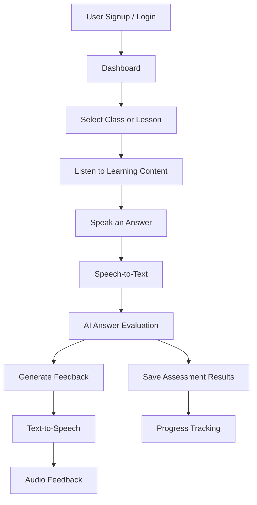

# VoiceEase 🎙️

### Voice-First Learning & Speech Practice Platform

**VoiceEase** is an accessibility-focused platform designed to make learning and speaking practice more inclusive through voice interaction and AI-assisted feedback. It aims to support visually impaired learners and individuals who want to build speaking confidence, including people who stammer.

---

## 📌 About the Project

Traditional learning platforms often depend heavily on visual interfaces, reading, and typing. VoiceEase explores a voice-first approach that enables users to interact with educational content through speech and audio feedback.

By combining accessible learning workflows, speech technologies, and AI-assisted evaluation, VoiceEase aims to create a more inclusive and interactive learning experience.

## 🎯 Objectives

* Make digital learning more accessible through voice-based interaction.
* Enable learners to engage with educational content using speech and audio.
* Support AI-assisted evaluation of spoken answers.
* Provide constructive feedback to encourage continuous improvement.
* Help learners and mentors monitor educational progress.
* Promote inclusive and independent learning experiences.

## ✨ Key Features

* **User Authentication:** Signup and login for accessing the platform.
* **Learning Management:** Student, class, lesson, and mentor management.
* **Voice-Based Learning:** Designed to support spoken interaction with educational content.
* **Speech-to-Text (STT):** Converts spoken responses into text for processing.
* **AI-Assisted Evaluation:** Intended to evaluate answers and provide relevant feedback.
* **Text-to-Speech (TTS):** Designed to deliver lessons and feedback through audio.
* **Progress Tracking:** Planned assessment history and learner progress monitoring.
* **Accessibility-Focused Experience:** Aims to reduce dependence on traditional text-based interaction.

*Note: Feature availability depends on the current implementation. Planned features are not necessarily live.*

---

## 🔄 Project Workflow



### How VoiceEase Works

1. **Authentication:** Users sign up or log in to access the platform.
2. **Learning:** Users access available classes and lessons.
3. **Voice Interaction:** Users listen to content and provide spoken responses.
4. **Speech Recognition:** Spoken responses are converted into text.
5. **AI Evaluation:** The response can be assessed against the question or an evaluation rubric.
6. **Personalized Feedback:** The system can generate constructive suggestions and deliver them through audio.
7. **Progress Monitoring:** Assessment results can be stored to support future progress analysis.

---

## 🏗️ System Architecture

VoiceEase is designed around a frontend, backend, database, and AI-powered voice-processing workflow.

| Component         | Responsibility                                     |
| ----------------- | -------------------------------------------------- |
| Frontend          | User interface, dashboards, and lesson interaction |
| Authentication    | Identity verification and access management        |
| Backend API       | Application logic and service communication        |
| Database          | User, class, lesson, and learning records          |
| Speech-to-Text    | Speech transcription                               |
| AI Evaluation     | Response analysis and feedback generation          |
| Text-to-Speech    | Audio generation from text                         |
| Progress Tracking | Assessment history and learning reports            |

The exact frameworks, database, authentication provider, and AI integrations should be documented after verifying the repository source code.

---

## 🛠️ Technology Stack

| Layer         | Technology                                                                 |
| ------------- | -------------------------------------------------------------------------- |
| Frontend      | To be confirmed from source code                                           |
| Backend       | To be confirmed from source code                                           |
| Database      | To be confirmed from source code                                           |
| Speech AI     | Gnani Voice AI was previously considered for integration                   |
| AI Evaluation | To be confirmed                                                            |
| Deployment    | Link We will be Uploading soon                                             |

---

## ♿ Accessibility & Inclusion

Accessibility is a core design goal of VoiceEase.

The project aims to:

* Provide audio-based access to educational content.
* Reduce reliance on reading and typing.
* Support spoken-answer practice.
* Deliver clear and encouraging feedback.
* Improve independent access to digital learning.

**Responsible AI:** Evaluating the meaning of an answer is different from measuring speech fluency. Reliable feedback about pauses, repetitions, or stammering-related speech patterns requires suitable audio analysis and validation.

---

## 🚀 Getting Started

Clone the repository:

```bash
git clone <YOUR_GITHUB_REPOSITORY_URL>
cd <YOUR_PROJECT_DIRECTORY>
```

Install dependencies using the package manager specified by the project, configure the required environment variables, and follow the setup instructions for the frontend and backend.

Create a `.env` file using the provided `.env.example`, if available.

**Security:** Never commit API keys, passwords, or production credentials to GitHub.

*Complete installation commands will be added after verifying the actual repository structure.*

---

## 🗺️ Roadmap

* [ ] Finalize and document authentication and role-based access.
* [ ] Enhance voice-based lesson interaction.
* [ ] Integrate and validate speech-to-text processing.
* [ ] Develop AI-assisted spoken-answer evaluation.
* [ ] Add text-to-speech feedback.
* [ ] Implement learner progress and mastery reports.
* [ ] Improve screen-reader and keyboard accessibility.
* [ ] Test usability with intended users.

*These are development goals, not claims that every feature is already implemented.*

---

## 🤝 Contributing

Contributions and ideas that improve accessibility, voice interaction, and inclusive learning are welcome.

1. Fork the repository.
2. Create a feature branch.
3. Make and test your changes.
4. Submit a pull request with a clear description.

---

## 📄 License

A license has not yet been specified. Choose an appropriate license before inviting public reuse or contributions.

---

## 🌍 Our Vision

VoiceEase aims to make learning more inclusive by bringing together accessible design, voice interaction, and responsible AI.

We envision a world where learners can access educational content, practise communication, and develop confidence through learning experiences that better suit their needs.

---

**VoiceEase — Your voice. Your learning. Your confidence.** 🎙️

